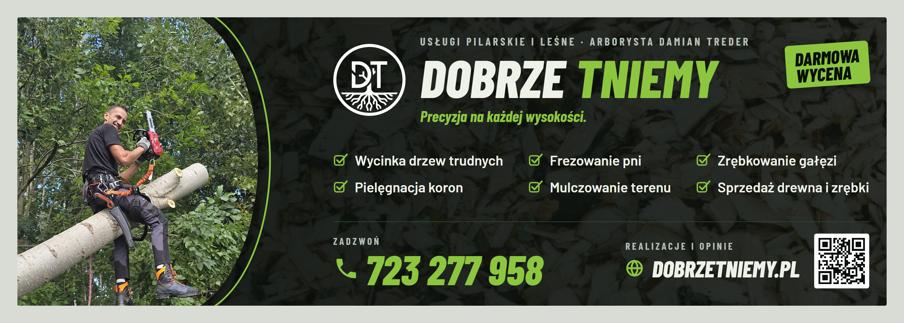

# Banner



A **3 × 1 m** banner with **3 cm bleed**, plus the Facebook cover. Text and the QR code stay at least 6 cm inside the trim, clear of hems and eyelets. The design is in `banner.html`, and `build.mjs` renders it with Chrome or Edge (or the browser set in `CHROME_PATH`):

```sh
npm ci
npm run build
```

Output in `dist/`: `baner-3x1m-dobrzetniemy.pdf` (3060 × 1060 mm), `facebook-cover.png` (1640 × 624), `preview.png`, and `qr.svg` (links to `https://dobrzetniemy.pl`, override with `BANNER_URL`). The PDF is vector apart from the photo and the background texture, both taken from `site/src/assets/photos/`.

## Before printing

- The PDF is RGB and the lime prints duller in CMYK: order a colour proof first.
- Scan the QR code on the proof.
- The photo is about 27 ppi at full size: sharp enough from a few metres, soft up close.
- If the print shop wants a different bleed, adjust `--bleed`, the `.print` size, the 9 em insets (bleed plus 6 cm) and `@page` in `banner.html`. Sizes are in `em`, and 1 em is 1 cm on the banner.
